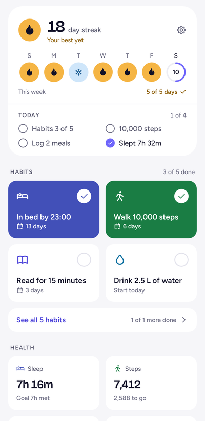
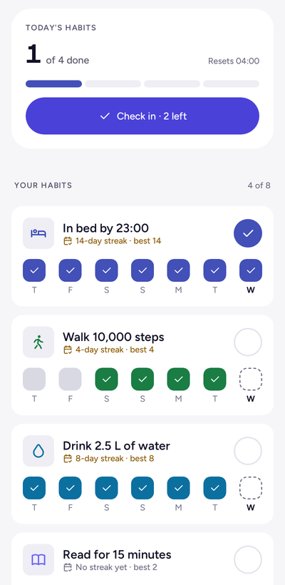
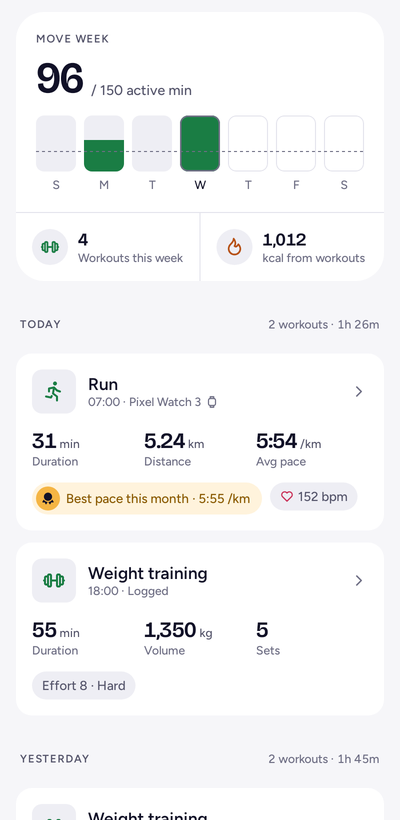
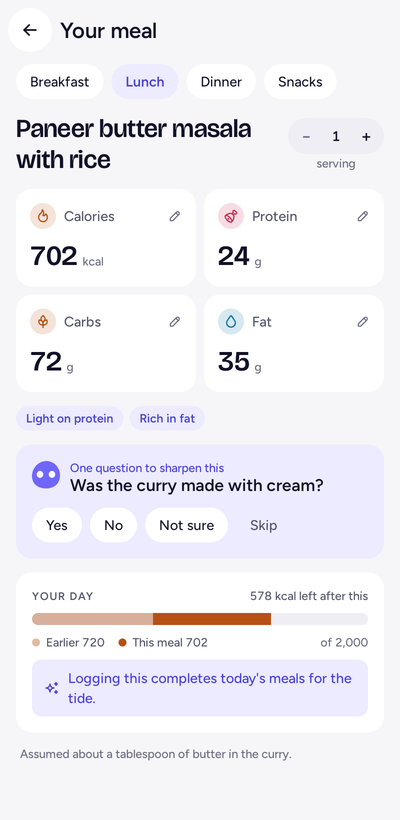
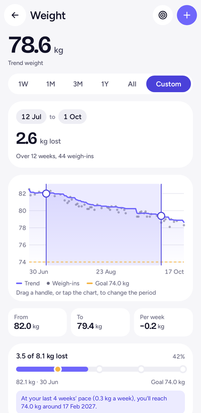
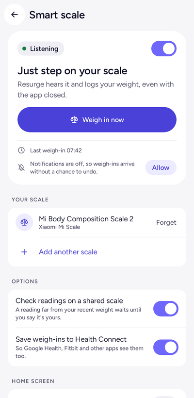
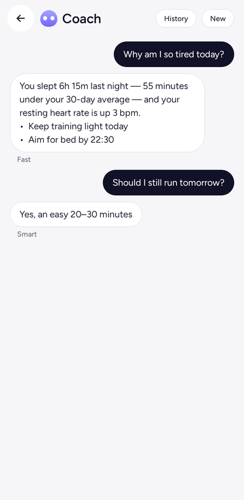
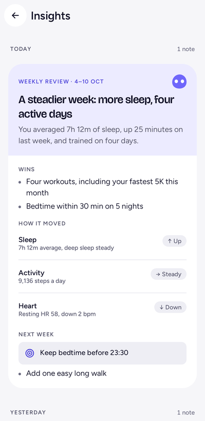
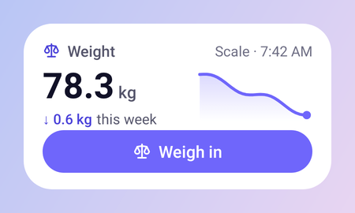

<div align="center">


# Resurge

**A calm AI health coach for Android.**<br>
Habits, sleep, movement, food and weight in one daily picture, with a coach that reads it and talks back.

[](LICENSE)


</div>

<p align="center">
  
  
  
  
</p>
<p align="center">
  
  
  
  
</p>

## Features

- **Today.** A day streak of days you did everything you set out to, a weekly goal, and your habits and health at a glance.
- **Habits.** One-tap check-ins, streaks with a weekly freeze, and private habits.
- **Fitness.** Workouts from Health Connect and ones you log yourself, merged into one feed. Cardio Points show daily intensity-weighted activity and 30 days of history, with separate cadence-based and estimated contributions.
- **Food.** Photograph or describe a meal; the coach estimates calories and macros and asks one question when it matters.
- **Weight.** A smoothed trend, a goal split into milestones, and history imported from Health Connect.
- **Smart scales.** Step on a Bluetooth scale and the weigh-in is logged, even with the app closed. [Supported scales](docs/smart-scales.md).
- **Snapshots.** Progress photos lined up against the last one, encrypted on the phone, with a reel every few weeks.
- **Coach.** Chat with a coach that sees your data, plus insights after workouts and sleep and a weekly review.

<p align="center">
  
</p>

Health data comes through [Health Connect](https://developer.android.com/health-and-fitness/guides/health-connect), so it works with Fitbit, Samsung Health, Garmin and most other apps.

### Cardio Points

Find Cardio Points below Move Week in Fitness. The compact card shows this week’s points and today’s total. Tap its footer to browse Sunday–Saturday weeks, select a day, and see sources and contributions. Expand **How points work** in the detail sheet for scoring rules; refresh is available there too. Points have no goal or streak effect.

- Cadence of 100–129 steps/min earns 1 point/min; 130+ earns 2. Short step records (at most 60 seconds) can supply a step-rate estimate. Daily totals and longer step records cannot establish intensity.
- Recognized workouts without usable cadence use the existing activity MET estimate: 3–<6 METs earns 1 point/min; 6+ earns 2. These contributions are labelled **Estimated**. Walking/running use available cadence, including zero for low cadence; other workouts use their activity estimate. Unknown activities have no automatic estimate.
- Workouts own their time and overlapping sources are counted once. Everyday movement contributes outside workouts. Daily totals round down after accumulating weighted duration; weeks add those daily totals.
- Scores are calculated and cached on this device for the last 30 days, excluded from backup, and cleared on sign-out. Raw samples are not retained. Cardio Points are not uploaded or sent to the coach; manual workouts still use their existing account storage.
- Missing permissions or recordings limit coverage. Manual workouts work without Health Connect. Refresh from Cardio Points details after changing Health Connect access in Settings; failed reads show stale results and can be retried.
- Workout imports use sessions started within the requested period. Cadence-series reads are bounded to retained history, with up to a one-minute boundary allowance, so recent recalculations can include overnight series. Older-starting series are outside the import range.

The moderate/vigorous principle follows [Google Fit’s published scoring rules](https://support.google.com/fit/answer/7619539?hl=en), but Cardio Points are Resurge’s calculation. Catalog estimates and source handling can differ: for example, Resurge’s cycling estimate is 7.5 METs, or 2 points/min. No heart rate is used in this version.

## How it's built

Kotlin and Jetpack Compose ([Compose Unstyled](https://composeunstyled.com)), Hilt, Firestore and WorkManager. The AI features run in Firebase Cloud Functions that call Claude, so no API key ships in the app.

```
app/          Entry point, navigation, notifications, widget
core/         Models, data, Health Connect, smart scales, design system
feature/      One module per screen: dashboard, habits, fitness, food, weight, scale, progress, coach, profile, auth
functions/    Cloud Functions (TypeScript): coach chat, meal analysis, insights
```

## Getting started

You need Android Studio with JDK 17+, Node.js 22, the [Firebase CLI](https://firebase.google.com/docs/cli), a Firebase project on the Blaze plan and an [Anthropic API key](https://console.anthropic.com).

1. **Firebase.** Add an Android app for `com.resurgeai.app.debug`, add your debug SHA-1 (`./gradlew :app:signingReport`), enable Google sign-in, and put `google-services.json` in `app/`. Create a Firestore database with the ID `resurge`, then run `firebase use --add`.
2. **Backend.**
   ```sh
   cd functions && npm install
   firebase functions:secrets:set ANTHROPIC_API_KEY
   cd .. && firebase deploy --only firestore:rules,firestore:indexes,functions
   ```
3. **App.** `./gradlew :app:installDebug`, or run `app` from Android Studio.

Without the backend, everything except the coach and meal logging still works.

## Tests

```sh
./gradlew testDebugUnitTest       # unit and screenshot tests
./gradlew recordRoborazziDebug    # re-record screenshots after a UI change
cd functions && npm test          # backend tests
```

## Releasing

1. Bump `versionCode` and `versionName` in `app/build.gradle.kts`.
2. In `CHANGELOG.md`, rename `## Unreleased` to `## 0.5.0 (date)`. It becomes the release notes.
3. Commit, then `git tag v0.5.0 && git push origin main v0.5.0`.

[The release workflow](.github/workflows/release.yml) publishes the signed APK on GitHub and keeps the Play bundle on the workflow run.

## Privacy

Your data lives under your account in Firestore, behind per-user security rules. Meal photos go to Claude for analysis and only a thumbnail is kept. Progress photos are encrypted before they leave the phone. Smart scales are only listened to, never connected to.

## Contributing

Issues and pull requests are welcome. Run the tests, re-record screenshots for UI changes, and use the design tokens in `Resurge.colors` and `Resurge.type` rather than literal colors.

## License

[GPL v3](LICENSE). You can use, study, change and share Resurge; if you distribute a modified version, release its source under the same license.
